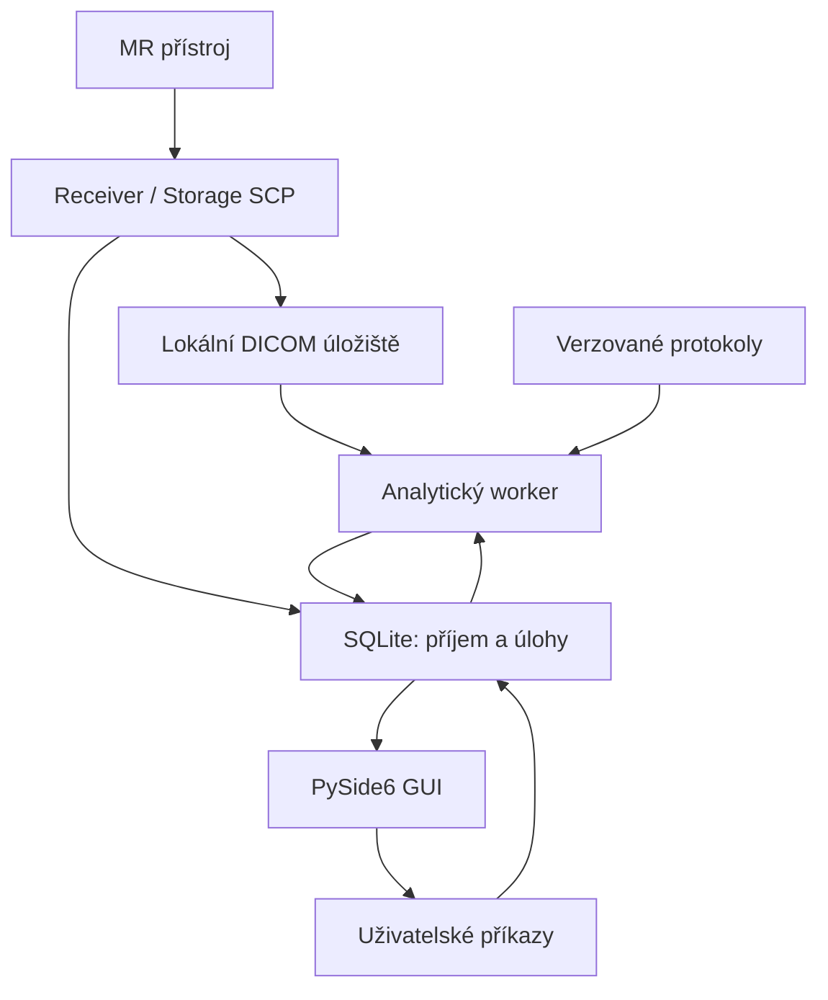
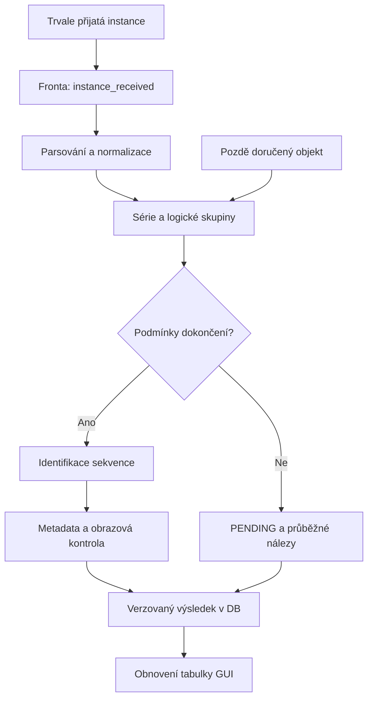

# MR Quality Monitor — návrh architektury (etapa 1)

Datum: 27. 11. 2026. Stav: návrh před implementací podle `prompt.md`.

## 1. Rozsah a hlavní rozhodnutí

Lokální jednookenní aplikace přijímá objekty z jednoho MR přístroje, průběžně sestavuje vyšetření a textově zobrazuje stav požadovaných sekvencí. Kontrola má tři oddělené vrstvy: přítomnost požadovaných sekvencí, kontrola akvizičních parametrů a kontrola obrazové kvality. Každá vrstva ukládá vlastní výsledek a důvody.

Tento dokument navrhuje software, nikoliv klinické limity. Bez schválené specifikace a ověřené metody obrazové analýzy aplikace nesmí vydávat automatický závěr „PI-QUAL splněno“. Neprovedená obrazová kontrola se zobrazí jako nevyhodnocená. Budoucí manuální hodnocení musí mít jméno hodnotitele a čas; automatické hodnocení verzi algoritmu.

Navrhuji tři samostatně spouštěné procesy:

1. **Receiver**: DICOM Storage SCP, bezpečné uložení a evidence příjmu.
2. **Worker**: parsování, agregace, rozpoznání a validace; bez síťové závislosti na GUI.
3. **GUI**: pouze čtení výsledků a zadávání explicitních uživatelských příkazů.

Na cílovém OS receiver a worker poběží pod správcem služeb, nezávisle na přihlášeném GUI. GUI je nesmí vlastnit jako procesy ukončované při zavření okna. Pro vývoj lze použít samostatné konzolové vstupní body. Přesný způsob instalace služby závisí na potvrzení OS.

## 2. Vstupní data a jejich dopad na návrh

Podkladem je `data/README.md` a přímo přečtený `report.json` z menšího ZIPu. Při implementaci etapy 2 dne 27. 11. 2026 byl navíc proveden přímý audit všech 321 hlaviček menšího ZIPu a síťový příjem celého případu; ten opravil původní chybný údaj o 13 fyzických sériích. Úplná klinická analýza pixelů provedena nebyla.

| Vlastnost podle dokumentace dat | Důsledek pro návrh |
| --- | --- |
| Menší ZIP: 321 objektů, 320 MR a jeden Secondary Capture | Rozlišovat SOP Class; report nehodnotit jako MR akvizici |
| Větší ZIP: 32 případů, 11 108 objektů; rozbalení přibližně 3,32 GB | Indexovat hlavičky, pixely načítat až při analýze; zpracovávat po případech |
| Skutečný rozsah adresářů MR50101–MR50132 neodpovídá konci názvu ZIPu | Výběr případů podle obsahu archivu |
| Soubory nemají příponu a archivy neobsahují index DICOMDIR | Offline import identifikuje soubory čtením, nikoliv příponou |
| Názvy souborů se opakují mezi případy | Identita objektu podle SOPInstanceUID, zdrojová cesta jen jako provenance |
| 14 fyzických sérií, 13 SeriesNumber a 14 řádků reportu v MR50000, ověřeno z hlaviček | Série klíčovat podle SeriesInstanceUID; SeriesNumber se může opakovat |
| TRACEW skupiny `*ez_b50t` a `*ez_b800t` mají v aktuálním ZIPu vlastní UID, stejný SeriesNumber 12 a popis, každá 26 instancí | Neslučovat podle názvu/čísla; pro jiné vstupy zachovat i podporu více logických skupin uvnitř jedné fyzické série |
| Data jsou podle README Explicit VR Little Endian | První integrační test pokryje tuto syntaxi; komprimované a Enhanced MR ověřit zvlášť |

`report.json` obsahuje očekávání `tier` a `scan_state`, anotace změn a vynechaných sérií. Jde o testovací oracle, nikoliv o vstup produkčního rozhodování. Klíče jeho `changes` se musí ověřit vůči skutečným hlavičkám; nelze z nich bez mapování vytvořit databázové série. Označení `optimal` samo neurčuje verzi ani skóre PI-QUAL.

## 3. Doporučený technologický stack

| Technologie | Úloha a důvod volby |
| --- | --- |
| Python 3.12 nebo novější podporovaná verze | Typovaný společný základ receiveru, analýzy i GUI; konkrétní verzi zamknout po ověření OS |
| pynetdicom | Storage SCP, asociace, C-STORE a volitelně C-ECHO pro diagnostiku |
| pydicom + NumPy | DICOM metadata, explicitní dekódování pixelů a práce s geometrií |
| PySide6, Qt Widgets | Jedno okno, tabulka a detail; bez potřeby webového serveru |
| SQLite + SQLAlchemy 2 | Lokální transakční evidence a oddělení modelů od dotazů |
| Alembic | Verzované migrace databáze a kontrolované upgrady |
| Pydantic 2 + PyYAML | Validace konfigurací a přenosových modelů, YAML načítaný bezpečným loaderem |
| pytest | Jednotkové, síťové a restartovací integrační testy |
| standardní logging | Rotované provozní logy bez pacientských hodnot |

Konkrétní verze závislostí budou uzamčené a instalátor bude obsahovat offline balíčky. Pixelové kodeky přidat jen pro skutečně podporované transfer syntaxe. Qt licence a licence případných kodeků ověřit před distribucí.

SQLite bude na místním disku, se zapnutými cizími klíči, WAL, `busy_timeout` a krátkými transakcemi. Receiver i worker mohou zapisovat, proto potřebují omezené opakování při obsazení databáze; nepoužívat jedinou SQLAlchemy Session mezi procesy. WAL umožňuje souběh čtení a zápisu, nikoliv neomezený souběh zapisovatelů [2]. Pro příjem požadujeme `synchronous=FULL` a ověření skutečného chování úložiště při restartu.

## 4. Komponenty a jejich odpovědnosti

| Modul | Odpovědnost a rozhraní |
| --- | --- |
| `dicom/listener` | Konfigurace AE, IP, portu, kontextů a povoleného odesílatele; síťové události |
| `dicom/receiver` | Minimální vstupní kontroly, evidence asociace, rozhodnutí o C-STORE odpovědi |
| `dicom/storage` | Dočasný soubor, kontrolní součet, atomické zveřejnění, karanténa a obnova |
| `dicom/metadata_parser` | Bezeztrátové čtení vybraných standardních hodnot, Shared/Per-frame Functional Groups |
| `vendors` | Rozhraní parserů Siemens/Philips/GE/Canon; neověřená vendor data zůstávají neznámá |
| `analysis/metadata_normalizer` | Jednotky, datové typy, provenance a konflikty hodnot |
| `analysis/series_aggregator` | Fyzické série, logické skupiny, snímky/rámce a revize úplnosti |
| `analysis/sequence_identifier` | Kandidáti sekvencí a důkazy identifikace |
| `analysis/validation_engine` | Deterministická pravidla a agregace stavů |
| `analysis/image_quality` | Rozhraní pro ověřené algoritmy nebo záznam manuálního hodnocení |
| `protocols` | Validace, výběr, neměnný snapshot a verze pravidel |
| `database` | Tabulky, repository, transakce a migrace |
| `services` | Koordinace vyšetření, fronty, finalizace a historie |
| `gui` | Tabulka, detail, výběr vyšetření a stav služby; žádná validační pravidla |
| `cli/import_dataset` | Budoucí offline import přes stejný příjmový mechanismus jako listener |

Navržené umístění implementace: balík `backend/mr_quality_monitor/`, konfigurace mimo Python v `config/`, testy v `tests/`. Existující `backend/listener/` nyní obsahuje pouze `.gitignore`; není zde hotový receiver, na který by bylo nutné navazovat. Runtime DICOM, databáze a logy budou v konfigurovatelném adresáři mimo Git a distribuovaný zdrojový kód.

## 5. DICOM workflow a bezpečné potvrzení příjmu

1. Receiver ověří konfiguraci a dostupnost úložiště/databáze, dokončí recovery a začne přijímat asociace. SOP Classes a transfer syntaxe jsou explicitně povolené. Výchozí rozsah: MR Image Storage a Secondary Capture; Enhanced MR až s ověřeným parserem rámců.
2. Asociace musí odpovídat konfigurovanému přístroji: volaný AE Title, volající AE Title a síťová adresa. AE Title není autentizační prostředek; firewall a případné TLS řeší síťovou ochranu.
3. C-STORE handler ověří UID, soulad SOP Class/Instance s příkazem a základní strukturu. Neprovádí nákladnou obrazovou analýzu. Příklady obsluhy C-STORE a ukládání s file meta poskytuje pynetdicom [1].
4. Vytvoří intake záznam se stavem `receiving`. Soubor zapíše do jedinečného staging názvu na stejném svazku jako cílové úložiště, doplní správná file meta, flushne a synchronizuje zápis.
5. Z uloženého souboru znovu přečte hlavičku, ověří identitu a dostupné délkové kontroly. Spočítá SHA-256 a atomicky soubor přesune na finální interní cestu. Absolutní cestu nikdy nesestavuje přímo z neověřených DICOM hodnot.
6. Krátká databázová transakce uloží instanci, příjmovou událost, zdrojový AE a UTC čas a vytvoří trvalou úlohu `instance_received`. Teprve po úspěšném dokončení vrátí úspěch C-STORE.
7. Selhání disku/databáze vrátí odpovídající neúspěšný C-STORE status a interní auditní důvod; nesmí vzniknout úspěšná odpověď bez trvalého příjmu. Klinická odchylka parametrů není důvod pro odmítnutí jinak uloženého objektu.

Soubor a SQLite nejsou jedna atomická transakce. Recovery při startu proto porovná intake záznamy, staging a finální soubory: dokončí potvrzené zápisy, znovu vytvoří chybějící úlohy a osiřelé/neúplné objekty přesune do karantény. Chybějící soubor již evidované instance je kritická provozní chyba, nikoliv tiché smazání záznamu.

**Duplicity:** unikátní SOPInstanceUID zabrání opakovanému zpracování. Stejný UID a stejný uložený obsah je idempotentní příjem s novou příjmovou událostí. Stejný UID a odlišný obsah se nepřepíše; uchová se jako konflikt v karanténě. Rozdíl SHA-256 mezi různými serializacemi sám nedokazuje rozdílné klinické pixely: pro podporované syntaxe lze doplnit kanonické porovnání datasetu/pixelů, jinak konflikt vyžaduje vyřešení. Souběžný příjem stejného UID řeší databázové omezení a oddělené staging názvy.

## 6. Datový tok a odolnost pracovní fronty

Fronta je tabulka SQLite, nikoliv jen paměťový callback. Worker získává úlohy krátkou transakcí s lease, počtem pokusů a termínem opakování. Po pádu vypršenou lease převezme další běh. Zpracování je alespoň jednou, proto zápisy musí být idempotentní: unikátní kombinace vstupní revize, verze parseru, protokolu a analytického kroku. Opakovaně vadná úloha skončí ve stavu `failed`, zobrazí se provozní problém a neblokuje další studie.

Receiver a worker mají samostatný heartbeat. GUI čte malé snapshoty pomocí vlastního čtecího pracovníka; Qt signály předávají data hlavnímu vláknu. Časovač pouze spouští aktualizaci, neprovádí nákladné DB dotazy ani dekódování pixelů. Fronta se měří počtem úloh, stářím nejstarší úlohy a volným diskem.

## 7. Metadata, fyzické série a logické sekvence

Studie se identifikuje pomocí StudyInstanceUID, fyzická série pomocí SeriesInstanceUID a instance pomocí SOPInstanceUID. PatientID ani SeriesNumber nejsou globální klíče. Pacientská identita zahrnuje IssuerOfPatientID nebo lokální namespace přístroje; při chybějící identitě se pacienti neslučují podle prázdné hodnoty či jména.

Parser zpracuje všechny položky uvedené v oddílu 4 zadání. Dále potřebuje Manufacturer, model a softwarovou verzi přístroje, SOP Class/transfer syntax, počet rámců, ImagePositionPatient, ImageOrientationPatient, difuzní b-hodnotu a směr, časovou pozici, echo a dostupné identifikátory dimenzí. Požadavek `PhaseEncodingDirection` mapuje především na standardní `InPlanePhaseEncodingDirection`; případné vendor rozšíření má odlišnou provenance a nesmí se bez geometrie vydávat za anatomický směr.

Každá normalizovaná hodnota má hodnotu, jednotku, stav `known/missing/invalid/conflicting`, zdrojový tag nebo cestu v sekvenci a verzi parseru. TR/TE/TI jsou v ms, geometrie v mm, úhel ve stupních a pole v T. Více hodnot se nezredukuje automaticky na první snímek; uchová se variabilita a konkrétní instance/rámec porušující pravidlo.

Priorita: standardní atribut odpovídajícího rámce, sdílené atributy, ověřený vendor parser. Konflikty se zaznamenají místo tichého přepsání. Privátní tagy se vyhledávají s private creator a verzí přístroje, nikoliv jen podle pevného čísla; pydicom takový přístup podporuje [3]. Neznámý výrobce nebrání standardnímu parsování, ale neověřené doplňky neposkytuje.

**LogicalAcquisition** reprezentuje hodnotitelnou podskupinu fyzické série. Klíč zahrne podle SOP Class orientaci a rozměry, echo, časovou pozici, difuzní b-hodnotu/směr a původní versus odvozený obraz. Pokud jedna série obsahuje více skupin, každá má vlastní členství a výsledek. Jedna protokolová definice může mít více kandidátních akvizic a opakování; volba použitého opakování je verzovaná a auditovaná, nesmí přepsat původní chybu.

## 8. Dokončení série a vyšetření

C-STORE přenáší objekty; přijetí jednoho souboru ani ukončení asociace zde nepovažujeme za důkaz dokončení vyšetření. Podmínky dokončení jsou součástí protokolu a integrace s konkrétním MR.

| Signál | Použití |
| --- | --- |
| Ověřený očekávaný počet instancí/rámců a dimenzí | Silný signál, pouze pokud je zdroj a jeho význam potvrzený |
| Ověřené externí dokončení nebo explicitní potvrzení obsluhou | Finalizace s evidovaným zdrojem a časem |
| Konfigurované období bez nových objektů | Jen předběžné ustálení, ne jistota úplnosti |
| `InstanceNumber` nebo `ImagesInAcquisition` | Pomocná informace, samostatně nedostatečná |

Životní cyklus: `receiving → quiescent → finalized`, s možností návratu do `receiving` po pozdním objektu. Uchovává se počet unikátních instancí i rámců, důvod dokončení a revize vstupu. Předběžně lze ukázat chybu již přijatých dat, ale úplný zelený výsledek až při splnění všech povinných kontrol a podmínek dokončení. Neznámá úplnost zůstává šedá, i když dostupná metadata vyhovují.

Chybějící povinná sekvence je během probíhajícího vyšetření PENDING. Teprve při explicitní finalizaci vyšetření se vyhodnotí jako chybějící s konfigurovanou závažností. Pravidlo pořadí se vztahuje k akvizičním údajům nebo potvrzenému workflow, nikoliv k pořadí síťového doručení.

## 9. Protokoly a validační engine

Protokol je JSON/YAML dokument validovaný Pydantic modelem. Obsahuje `schema_version`, identifikátor, verzi, označení DEMO nebo schválení, autora, klinický zdroj a seznam definic. Každá definice má pořadí, povinnost, pravidla rozpoznání, podmínky úplnosti, pravidla metadat, pravidla obrazové kontroly a doporučené akce.

Podporované operátory: přesná hodnota, množina hodnot, uzavřený interval a číselný cíl s absolutní nebo relativní tolerancí. Pravidlo musí definovat jednotku, povinnost, závažnost a agregaci (`all`, rozsah hodnot nebo jiný explicitní výpočet). Pro `target ± tolerance` je tolerance výslovně absolutní či procentní; kombinace neslučitelných operátorů je chyba konfigurace. Tolerované hodnoty uvnitř povolené oblasti jsou GREEN; oddělené varovné pásmo dovoluje ORANGE před kritickou hranicí. U vícesložkových hodnot musí být uvedeno porovnání po složkách nebo odvozená metrika.

Validátor konfigurace odmítne duplicitní ID, neplatné jednotky, zápornou toleranci, min > max, chybějící referenci nebo neslučitelný typ. Požadovaná chybějící metadata vytvoří issue s nastavenou závažností nebo stavem nevyhodnotitelnosti. Chybějící nepovinná hodnota sama nevytvoří klinickou chybu.

Identifikace kombinuje více znaků: modalitu/SOP Class, ImageType, geometrii/orientaci, akviziční typ, difuzní parametry, názvy a vendor informace. SeriesDescription je jen jeden konfigurovaný signál. Výstup obsahuje kandidáty a důkazy. Žádný kandidát znamená UNKNOWN; více rovnocenných kandidátů AMBIGUOUS. Žádná shoda se nevybere jen podle pořadí pravidel.

Engine má čisté rozhraní: normalizovaná revize akvizice + snapshot protokolu + verze algoritmů → výsledek a issues. Čas vyhodnocení dodává orchestrace. Opakování se stejným vstupem musí dát stejný obsah nálezů. Report ze ZIPu se do tohoto rozhraní nepředává.

| Výsledný stav | Pravidlo agregace |
| --- | --- |
| RED / CRITICAL | Alespoň jeden prokázaný kritický nález; i při dalších nehotových kontrolách |
| GRAY / PENDING nebo UNKNOWN | Bez kritického nálezu, ale povinná kontrola není dokončená, identifikace je nejasná nebo výsledek není spolehlivý |
| ORANGE / WARNING | Všechny povinné kontroly provedené, alespoň jedna tolerovatelná odchylka |
| GREEN / OK | Dokončená akvizice a všechny povinné kontroly splněné |

Varování se neztrácejí, pokud je celkový stav šedý: tabulka ukáže „nevyhodnoceno; nalezeno varování“. Samostatně se ukládají `metadata_status`, `image_status`, `completeness_status` a `overall_status`. Kontrola integrity pixelů nebo geometrie může prokázat technický problém, sama však nenahrazuje odborné hodnocení obrazové kvality. Nenainstalovaný či neověřený obrazový analyzátor vrací UNKNOWN.

Každý výsledek obsahuje naměřené a požadované hodnoty včetně jednotek, operátor, pravidlo, závažnost, důvod, doporučení, zdrojovou instanci/rámec, čas a úplnou verzi vstupů. PI-QUAL verzi, převod dílčích výsledků na skóre a vztah k PI-RADS je nutné dodat před implementací klinických pravidel. Ilustrační limity v zadání nebudou vydávány za klinické hodnoty.

Při zahájení vyšetření se zamkne snapshot protokolu s hashem. Nový soubor ovlivní až další vyšetření. Zpětné přehodnocení vytvoří novou větev výsledků s důvodem a uživatelem; historické výsledky zůstávají zachované.

## 10. Návrh databázových tabulek

Společná pravidla: interní ID, UTC auditní časy, cizí klíče a explicitní stav. Datumy/časy z DICOM se zachovají také v původní podobě s informací o dostupné zóně; chybějící zónu nelze svévolně doplnit.

| Tabulka | Hlavní sloupce a omezení |
| --- | --- |
| Patients | `id`, lokální token, PatientID a issuer v chráněné podobě podle politiky; PatientName volitelně; žádný globální UNIQUE na samotném PatientID |
| Studies | `id`, `study_uid UNIQUE`, `patient_id FK`, accession, DICOM datum/čas, scanner ID, stav, `protocol_version_id FK`, finalizace a její původ |
| Series | `id`, `series_uid UNIQUE`, `study_id FK`, SeriesNumber, popis, lifecycle, počty instancí/rámců, poslední příjem, revize |
| DicomInstances | `id`, `sop_instance_uid UNIQUE`, `series_id FK`, SOP Class, transfer syntax, interní cesta, velikost, SHA-256, počet rámců, první příjem, integrity stav |
| ReceptionEvents | `id`, instance nebo intake ID, čas, zdrojový AE/IP, asociace, výsledek, duplicate/conflict; více příjmů jedné instance |
| IntakeRecords | `id`, identita příjmu, staging/final cesta, stav, UID, checksum; podklad recovery |
| LogicalAcquisitions | `id`, `series_id FK`, klíč skupiny, normalizovaná geometrie/dimenze, lifecycle, důvod dokončení, revize |
| AcquisitionMembers | `acquisition_id FK`, `instance_id FK`, číslo rámce, `UNIQUE` nad členstvím; dohledatelné vstupy skupiny |
| MetadataSnapshots | `id`, instance/akvizice FK, revize, verze parseru, JSON hodnot a provenance, hash; snapshoty se nepřepisují |
| ProtocolVersions | `id`, protocol ID + version UNIQUE, schéma, kompletní obsah, hash, DEMO/schváleno, původ a datum schválení |
| SequenceDefinitions | `id`, `protocol_version_id FK`, sequence ID, pořadí, required, definice JSON; UNIQUE v rámci verze |
| SequenceAssignments | studie, definice FK, akvizice FK, kandidáti/důkazy, revize a volba opakování; zachovává nejednoznačnost |
| ValidationResults | `id`, studie FK, akvizice/definice FK podle scope, metadata snapshot FK, protocol FK, verze enginu/algoritmu, stavy, důvod, čas, autor, supersedes FK |
| ValidationIssues | `id`, `result_id FK`, rule ID, vrstva, parametr, skutečnost/očekávání JSON, jednotka, závažnost, text, zdroj instance/rámce |
| AnalysisJobs | `id`, typ, entity ID, input revision, stav, lease, pokusy, next retry, sanitizovaná chyba; unikátní klíč idempotence |
| UserCommands | `id`, typ, studie FK, payload, autor, čas, stav a výsledek; finalizace a přehodnocení provádí worker |
| SystemEvents | `id`, čas, komponenta, typ, závažnost, interní korelační ID, sanitizovaný detail a uživatel |
| ServiceHealth | service ID UNIQUE, heartbeat, běh ID, bind/AE, počty, poslední úspěšný příjem, poslední chyba |

Vztahy: pacient 1:N studie; studie 1:N fyzické série; série 1:N instance a logické akvizice; akvizice N:M instance/rámce přes členství; protokol 1:N definice; výsledky odkazují na konkrétní vstupní snapshot a mají 1:N issues. Scope výsledku umožní také nález chybějící sekvence bez existující akvizice.

Indexy: studie podle UID, série podle studie, instance podle série, úlohy podle stavu/next retry/lease, výsledky podle studie/akvizice/času a události podle času. Historie stavů se odvozuje z neměnných výsledků včetně `supersedes`; aktuální přehled je pouze obnovitelná projekce.

## 11. Jednookenní GUI

Horní část: volba vyšetření, PatientID nebo token, volitelné jméno, accession, datum, přístroj, aktivní protokol/verze a souhrnný stav. Příchod jiné studie nesmí bez upozornění přepnout právě kontrolované vyšetření.

Střed: řádek pro každou požadovanou sekvenci v pořadí protokolu. Sloupce: pořadí, název, stav, TR, TE, tloušťka, snímky/rámce, metadata, obrazová kvalita, důvod a akce. Neznámé/pomocné série mají samostatné řádky pod požadovanými. Opakování lze rozbalit. Barva je doplněna textem a symbolem pro přístupnost.

Dolní panel po výběru řádku: naměřené/očekávané hodnoty, jednotlivé nálezy, provenance a historie. Bez obrazového prohlížeče; zadání požaduje jednoduchý textový přehled.

Stavová lišta: naslouchající IP/port/AE, dostupnost receiveru a workeru, probíhající asociace, počet unikátních objektů, poslední příjem, backlog a chyby. „Naslouchá“ a „připojeno k MR“ jsou různé stavy; DICOM asociace nemusí být trvale otevřená. Zastaralý heartbeat zobrazí nedostupnost, nikoliv poslední známou zelenou indikaci.

## 12. Ochrana dat a provoz

Původní DICOM může obsahovat osobní údaje v hlavičkách, privátních elementech i přímo v pixelech. Minimalizace indexu ani skrytí jména neznamená anonymizaci originálu. Úložiště, DB, zálohy a karanténa musí mít omezená OS oprávnění a šifrovaný disk; klíče spravuje lokální infrastruktura. SQLite samo o sobě neřeší autentizaci ani šifrování.

Navržené role: operátor čte a finalizuje, správce mění konfiguraci, schvalovatel zavádí schválené protokoly. Prosazení rolí patří do služby i OS oprávnění, nikoliv pouze skrytých GUI tlačítek. Do stanovení autentizace nelze tyto role označit za implementované bezpečnostní opatření.

Žádná telemetrie, cloud ani automatické odesílání DICOM. Provozní logy neobsahují PatientName/PatientID, dumpy datasetů ani souborové cesty s identitou. Rotace logů, kvóty, retenční období, mazání a zálohování budou konfigurované. Zálohu DB vytvořit konzistentním SQLite backup postupem spolu s manifestem souborů, ne pouhým kopírováním živého `.db` bez WAL.

Při nedostatku disku služba nesmí potvrdit neuložený objekt. Při pádu GUI příjem pokračuje, při pádu workeru zůstává fronta trvalá, při pádu receiveru jej restartuje správce služeb. Audit v lokální DB je dohledatelný, ale bez dalších opatření není nezměnitelný vůči administrátorovi stroje.

## 13. Rizika a řešení

| Riziko | Opatření / podmínka přijetí |
| --- | --- |
| Chybějící klinická specifikace | Pouze DEMO, žádné domyšlené PI-QUAL limity; schválit zdroj a verzi pravidel |
| Parametry vyhovují, obraz je nekvalitní | Oddělené výsledky, UNKNOWN pro neprovedenou obrazovou kontrolu |
| Pauza přenosu zaměněná za dokončení | Rozlišovat quiescent/finalized, audit finalizace, revize po pozdním objektu |
| Více difuzních skupin v jedné sérii | Logické akvizice a kontrola členství podle skutečných metadat |
| Vendor/softwarová variabilita | Verzované adaptéry a kontraktní testy na anonymizovaných hlavičkách |
| Enhanced MR či komprimované pixely | Explicitní matice podporovaných SOP/transfer syntaxí a testy rámců/kodeků |
| Pád mezi uložením souboru a DB | Intake journal, atomické přesuny, recovery a fault-injection testy |
| Duplicitní UID s odlišným obsahem | Karanténa, žádný tichý overwrite, audit konfliktu |
| SQLite zámky nebo dlouhá analýza | Krátké transakce, WAL, retry, analýza mimo transakci a sledování backlogu |
| Zamrzlé GUI nebo restart uživatele | Nezávislé služby a heartbeat; GUI čte přes pracovní vlákno |
| Nechtěná změna protokolu | Neměnný snapshot/hash, explicitní verzované přehodnocení |
| Únik údajů z dat či logů | OS ACL, šifrovaný disk, minimalizace, sanitizace a retenční politika |
| Nejasný význam reportových anotací | Dokumentované mapování oracle; produkční engine reporty nečte |
| Záměna pořadí příjmu a měření | Kontrola pořadí podle ověřených akvizičních údajů |

## 14. Postup dalších etap a ověření

| Etapa | Konkrétní výstup a podmínka dokončení |
| --- | --- |
| 2 — listener | Síťový C-STORE syntetických MR a SC, bezpečný příjem, duplicity, konflikt UID, odmítnutí neuložených dat, recovery; C-ECHO jako diagnostika |
| 3 — metadata | Standardní parser, provenance/jednotky, ověřené vendor rozhraní, chybějící/konfliktní hodnoty, rozdělení TRACEW a geometrie objemu |
| 4 — engine | Validace DEMO protokolu, rozpoznání včetně ambiguity, všechny čtyři stavy, hranice intervalů/tolerancí, nepovinné hodnoty, nevyhodnocený obraz |
| 5 — databáze | Plná historie, migrace a snapshoty; fault-injection/restart, opakování úloh, zamknutí protokolu a izolace studií |
| 6 — GUI | Jedno okno, stavy a detail, stale heartbeat, neblokující aktualizace a pokračující příjem po zavření GUI |
| 7 — integrace | Offline import i síťový přenos celých případů, pozdní snímky, souběh studií, restart všech procesů a offline instalace |

Minimální příjmová evidence a trvalá fronta vzniknou již v etapě 2; etapa 5 je rozšíří o plný doménový model. Odolnost příjmu nelze odložit až za analýzu.

Unit testy používají výhradně generované syntetické identity a pixely. Dodané ZIPy jsou oddělená lokální integrační sada; před jejím sdílením nebo použitím v CI je nutné ověřit anonymizaci včetně pixelů. Nejprve menší případ, pak 32 případů streamovaně bez hromadného načítání pixelů. Výsledky se porovnávají s reportem až po potvrzení významu jeho anotací, nikoliv pouze podle názvů sekvencí. Výkonové limity stanovíme po dodání očekávaného průtoku a parametrů PC.

## 15. Informace potřebné před implementací

1. **Cílový systém a nasazení:** verze Windows/Linux, oprávnění instalovat službu, typ přihlášení, parametry PC, umístění a kapacita disku.
2. **Přístroj a síť:** výrobce/model/verze SW, DICOM Conformance Statement, IP a AE obou stran, port, firewall a požadavek na TLS; které SOP Classes a transfer syntaxe MR skutečně posílá.
3. **Klinický protokol:** konkrétní verze PI-QUAL, typ vyšetření, bpMRI/mpMRI, seznam sekvencí, povinnosti, pořadí, přesné parametry/jednotky, tolerance a kritičnost; kdo pravidla odborně schvaluje.
4. **Obrazová kontrola:** očekávané artefakty/metriky, automatické versus manuální hodnocení, referenční anotace, dostupné ověřené algoritmy a význam konečného skóre.
5. **Dokončení a opakování:** jak přístroj signalizuje konec série/vyšetření, zda poskytuje spolehlivé počty, přípustná prodleva a kdo vybírá použité opakování.
6. **Testovací sada:** původ a ověření anonymizace, přesný význam `tier`, `scan_state`, `expected_pirads_param` a artefaktových anotací; zda má být sada závazným očekáváním nebo jen ukázkou.
7. **Ochrana dat:** povolené identifikátory/jméno v GUI, autentizace/role, retence, šifrování, zálohy, přístup správce a auditní požadavky.
8. **Provoz:** maximální počet objektů/velikost vyšetření, průtok, požadovaná rychlost upozornění, jazyk GUI, počet současně otevřených studií a pravidla při odstávce.

Tyto body nebrání dokončení návrhu. Síťové a OS parametry jsou potřeba před testováním receiveru na přístroji; schválená pravidla a metoda obrazového hodnocení jsou potřeba před klinickým vyhodnocováním. Vývoj bez nich může pokračovat pouze v jasně označeném DEMO režimu.

## 16. Technické zdroje

Ověřeno při přípravě návrhu; návrhová rozhodnutí, jako tři procesy nebo lokální fronta, jsou doporučením pro tento projekt.

1. [pynetdicom — Writing your first SCP](https://pydicom.github.io/pynetdicom/stable/tutorials/create_scp.html): Storage SCP, C-STORE handler, file meta a stavové odpovědi.
2. [SQLite — Write-Ahead Logging](https://www.sqlite.org/wal.html): souběh čtení/zápisu a omezení WAL na stejný host.
3. [pydicom — Dataset](https://pydicom.github.io/pydicom/stable/reference/generated/pydicom.dataset.Dataset.html): přístup ke standardním a privátním elementům.
4. [Qt for Python — QTimer](https://doc.qt.io/qtforpython-6/PySide6/QtCore/QTimer.html): časovače a vztah k event loop.
